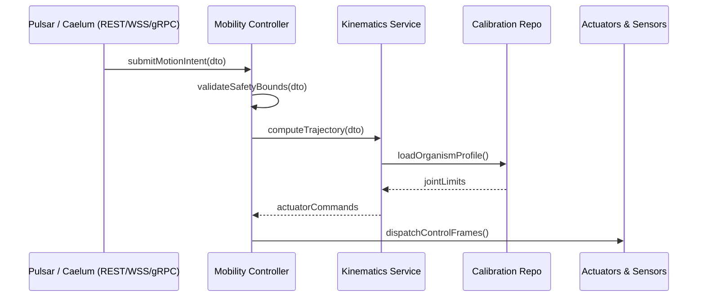

<p align="center"></p>

<h1 align="center">Pleaides</h1>
<p align="center"><strong>Sovereign robotic mobility, kinematics, and multi-hardware actuation utility in pure Rust</strong></p>

<p align="center">
  
  
  
  
  <a href="LICENSE"></a>
  <a href="https://natuleadan.com"></a>
</p>

## 1. What is Pleaides?

Pleaides is a sovereign, pure-Rust utility and control runtime for **robotic organism mobility**, actuation, and hardware-agnostic motion logic, using Orion's factored service patterns and communicating with sibling constellations strictly over decoupled network protocols (REST, WebSocket/WSS, gRPC) without direct Cargo crate coupling. Engineered with modular compatibility layers across diverse, abundant microcontrollers, chips, edge boards, and companion compute nodes, Pleaides decouples high-level mobility logic from vendor-specific robotics middleware.

### What is inside

Pleaides follows the layered modular six-file modular domain architecture (`entity`, `dto`, `repository`, `service`, `controller`, `mod`) inside a pure-Cargo workspace (`crates/core` and `crates/xtask`), governed by eight automated validation gates and a 3-day dependency publish cooldown.

> **Current scope:** This release ships the native validation harness, the six-file modular reference domain (`modules/math`), and the crate contracts. Transports, sandboxes, domain engines and protocol integrations described throughout this document are planned milestones, not shipped capabilities.

## 2. Why Pleaides?

Robotics software often locks mobility logic into bloated, OS-specific middleware stacks that are difficult to port across microcontrollers, edge boards, and autonomous agent harnesses.

- **Decoupled wire-protocol integration**: Exposes Orion-patterned service endpoints (REST, WSS, gRPC) to interact with Pulsar, Caelum, and sibling constellations without direct Cargo dependencies.
- **Modular motor-control layers**: Abstracts kinematics and actuation so hardware drivers remain interoperable across diverse robotic hands, limbs, and actuators.
- **Broad hardware compatibility**: Targets common, abundant microcontrollers, embedded chips, and edge boards through layered hardware adapters rather than locking into a single chip family.
- **Strict boundary tripwires**: Automated architecture tests ensure safety invariants and hardware drivers stay cleanly separated.

## 3. Highlights

- **Deterministic mobility primitives**: Typed motion commands, kinematic constraints, and safety interlocks in native Rust.
- **Pure Cargo automation via `xtask`**: Native `cargo xtask validate`, `notices`, and `release` commands.
- **Eight standardized validation gates**: Full verification across lint, typecheck, unit tests, architecture boundaries, cooldown, hygiene, notices, and releases.
- **Supply-chain hardening**: 3-day package publish cooldown (`resolver.min-publish-age="3 days"`), SBOM inventory, and CodeQL analysis.
- **Zero formatter drift**: Formatters are excluded from hooks and CI so diffs remain clean and reviewable.

## 4. Quick Start

Ensure Rust `1.85+` (Rust 2024 edition / stable, matching `rust-version = "1.85"`) is installed:

```bash
# Clone the repository
git clone https://github.com/natuleadan/pleaides.git
cd pleaides

# Activate local hooks
git config core.hooksPath .githooks

# Run the complete 8-gate native validation suite
cargo xtask validate
```

Other native `xtask` operations:

```bash
cargo xtask notices          # Regenerate ThirdPartyNotices.txt from cargo metadata
cargo xtask release --check  # Verify Cargo.toml version and CHANGELOG parity
cargo test --workspace       # Execute unit, integration, and architecture tests
```

## 5. Use Cases

- **Robotic organism locomotion**: Coordinate multi-DOF limbs, wheeled bases, or articulated joints with bounded safety limits.
- **Agent-commanded physical actions**: Allow Pulsar harnesses and Caelum spatial loops to dispatch verified, safety-checked mobility intents over decoupled wire protocols (REST, WSS, gRPC).
- **Multi-device hardware abstraction**: Port identical mobility logic across simulation, edge compute, and embedded actuator controllers.

## 6. How It Works



Motion intents arrive over decoupled wire protocols from Pulsar or Caelum through the `controller`, validate safety envelopes via `dto`, compute trajectories inside `service`, and read organism profiles through `repository` ports before commanding actuators.

## 7. Status and Roadmap

- **Status**: Initial foundation — validation harness and modular reference skeleton in place; domain implementation in progress.
- **Milestone 1**: Core robotic organism entity model, safety-envelope DTOs, and Orion-patterned REST/WSS/gRPC service contracts.
- **Milestone 2**: Kinematics, trajectory planners, and multi-device actuator/sensor hardware traits.
- **Milestone 3**: Real-time bridge integration with Pulsar harnesses and embedded/IoT targets.

## 8. Repository Layout & Validation Gates

```text
.
├── .cargo/                  # Cargo configuration and 3-day cooldown resolver
├── .githooks/               # Versioned commit-msg, pre-commit, and pre-push hooks
├── .github/                 # Issue templates, dependabot config, and CI workflows
├── crates/
│   ├── core/                # Core mobility library (modules/math reference domain, lib.rs)
│   │   └── tests/           # integration.rs and immutable architecture.rs tripwires
│   └── xtask/               # Pure-Rust automation CLI (cargo xtask <cmd>)
├── .env.example             # Environment contract template (copy to git-ignored .env)
├── Cargo.toml               # Workspace manifest (rust-version = "1.85", [workspace.lints])
├── clippy.toml              # Strict Clippy policy (max-fn-params-bools = 0)
├── ARCHITECTURE.md          # Modular domain architecture specifications
├── AGENTS.md                # Autonomous AI agent operating guidelines
├── CONTRIBUTING.md          # Contribution workflow and commit grammar
├── SECURITY.md              # Supply-chain policies and vulnerability reporting
├── LICENSE                  # Apache-2.0 License
├── NOTICE                   # Copyright (c) 2026 Natuleadan.
└── ThirdPartyNotices.txt    # Automated third-party license inventory
```

| Gate | Command | Purpose |
| :--- | :--- | :--- |
| `lint` | `cargo clippy --workspace --all-targets --all-features -- -D warnings` + `cargo doc -D warnings` | Strict zero-warning static analysis and rustdoc checks |
| `typecheck` | `cargo check --workspace --all-targets` | Workspace type verification |
| `unit tests` | `cargo test --workspace --lib` + `--doc` | Library unit tests and runnable doc examples |
| `integration and architecture tests` | `cargo test --workspace --test '*'` | Integration flows and layer tripwires |
| `cooldown` | `cargo --config 'resolver.min-publish-age="3 days"'` | 3-day package release cooldown |
| `hygiene` | `crates/xtask/src/hygiene.rs` | 500-line limit, anti-leak, and syntax checks |
| `notices` | `crates/xtask/src/notices.rs` | License inventory parity check |
| `release` | `crates/xtask/src/release.rs` | SemVer and CHANGELOG consistency |

## 9. Documentation

- [ARCHITECTURE.md](ARCHITECTURE.md): Modular architecture, layer boundaries, and design invariants.
- [CONTRIBUTING.md](CONTRIBUTING.md): Issue-first contribution policy, PR workflow, and commit grammar.
- [SECURITY.md](SECURITY.md): Vulnerability disclosure procedures and supply-chain controls.
- [AGENTS.md](AGENTS.md): Machine-facing instructions for autonomous engineering.

## 10. Ecosystem & Community

Pleaides is the robotic mobility constellation of Natuleadan, using Orion's factored patterns and communicating strictly over decoupled wire protocols (REST, WSS, gRPC) with Orion, Andromeda, Aurora, Pulsar, Caelum, Lyra, and Skills.

<p align="left">
  <a href="https://github.com/natuleadan"></a>
  <a href="https://github.com/leojara95"></a>
</p>

Bug reports and feature proposals are tracked via structured GitHub Issues.

## 11. Contributing

External pull requests are restricted to maintainers (`collaborators_only`). Please open an issue describing your bug or proposal. See [CONTRIBUTING.md](CONTRIBUTING.md) for details.

## 12. License & Star History

This project is licensed under the Apache License 2.0. Copyright (c) 2026 Natuleadan.

Terms are in [LICENSE](LICENSE), attribution in [NOTICE](NOTICE), and third-party dependency notices in [ThirdPartyNotices.txt](ThirdPartyNotices.txt).

<a href="https://www.star-history.com/#natuleadan/pleaides&Date">
  <picture>
    <source media="(prefers-color-scheme: dark)" srcset="https://api.star-history.com/image?repos=natuleadan/pleaides&type=date&theme=dark" />
    <source media="(prefers-color-scheme: light)" srcset="https://api.star-history.com/image?repos=natuleadan/pleaides&type=date&theme=light" />
    
  </picture>
</a>
